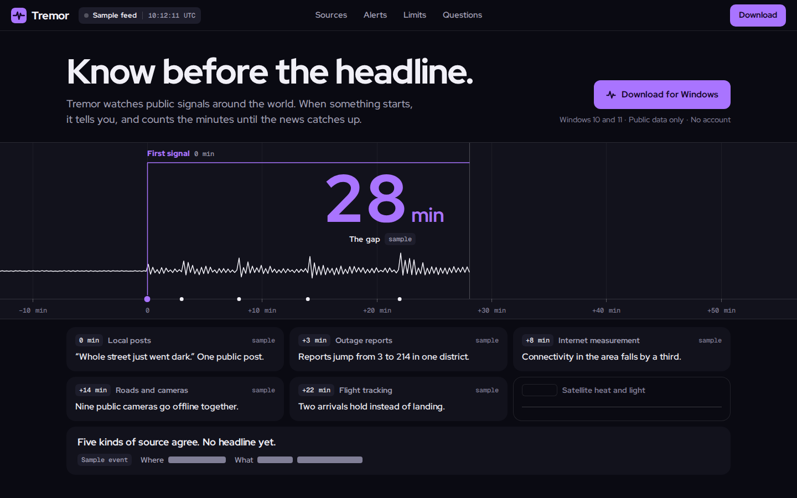
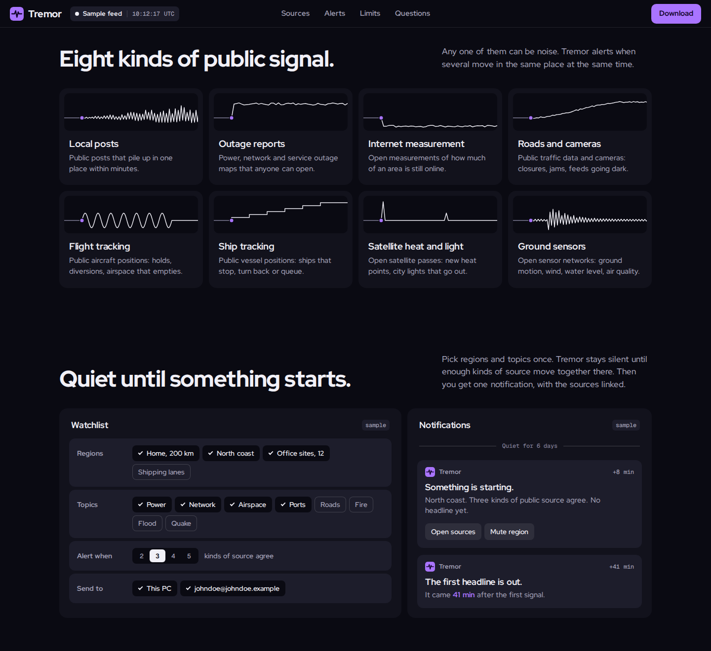
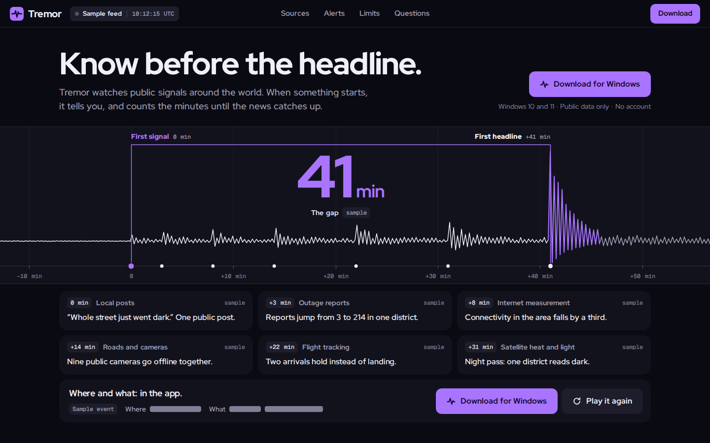

<h1 align="center">Tremor: OSINT event monitoring from open sources</h1>

<b>Know before the headline.</b> Watches public signals around the world and tells you something is happening before the news does.

OSINT · OSINT tool · event monitoring · real-time alerts · open sources · early warning · GEOINT · windows

> **Status: v0.5.0.** The app is out — [download Tremor for Windows](https://awesomeosint.tools/tremor/).

## Why this exists

By the time something is a headline, it is old. The first signals are always quieter: a feed, a wire, a sudden change in a quiet place.

## Why it is different

News apps show what happened. Tremor watches the public signals underneath — feeds, wires, open data — and alerts you when something starts, before it is a headline.

## The idea

- **One object.** A seismograph trace: one line that is flat until something starts.
- **One number.** The gap: the minutes between the first public signal of an event and the first news headline about it.
- **Colour.** Night `#0A0A12` and white. Violet `#A974FF` marks the tremor itself (the spike, the first-signal marker, the gap) and the download.
- **The main feature.** The gap. Tremor marks the first public signal and the first headline on the same trace and shows the time between them.

## The demo on the page

A pen draws one trace across the whole window. It is quiet, then the first public signal lands and a violet bracket starts counting minutes. Six cards under the trace wake up in time order, one per kind of source (local posts, outage reports, internet measurement, cameras, flight tracking, a satellite pass). At 41 minutes the first headline arrives and the trace spikes. Then it stops: the gap is shown, but where the event is and what it is stay covered, and the strip offers the download and "Play it again".

The run pauses when the instrument is off screen or the tab is hidden. With reduced motion it shows the finished state at once.

